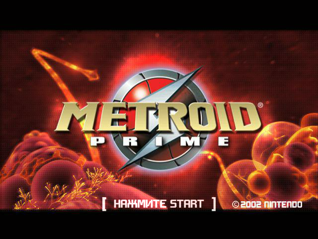
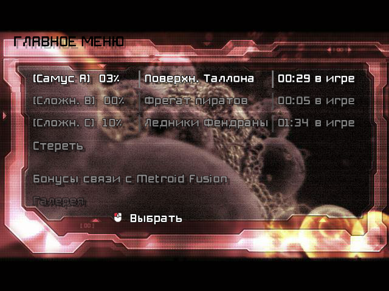
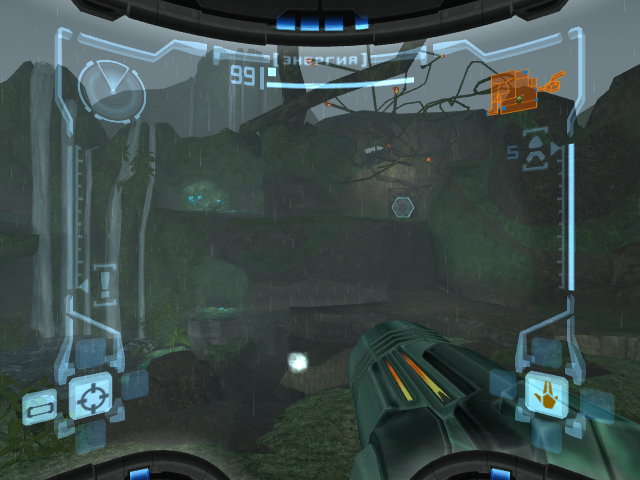
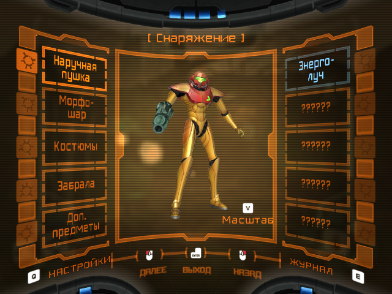
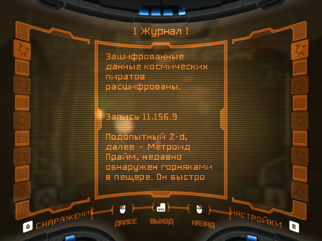
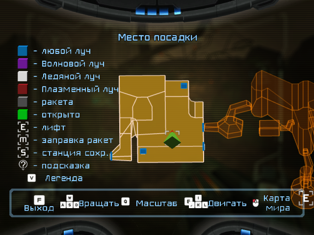

# Metroid Prime: русский перевод для нативного порта

Полный перевод Metroid Prime (GameCube, USA 1.00) для ПК/Android-порта
[Odrannnn/MetroidPrimePort](https://github.com/Odrannnn/MetroidPrimePort): меню, подсказки,
сканы, журнал и титры, все 2141 строка. В шрифты игры дорисована кириллица, надписи на текстурах
(«ЭНЕРГИЯ», «НАЖМИТЕ START», названия регионов в лифтах) перерисованы по-русски. С импортом
Remastered текст рисуется HD-шрифтом с кириллицей.

В репозитории нет данных Nintendo: мод собирается у каждого из его собственного диска.

| | |
|---|---|
|  |  |
|  |  |
|  |  |

## Что нужно
- порт **v0.34.0** (проверено на нём; работа с другими версиями не гарантируется);
- свой образ **Metroid Prime USA 1.00** (`GM8E01`, ревизия 0) в ISO; другие ревизии и PAL
  не поддерживаются;
- Python 3 с пакетами Pillow и numpy: `pip install Pillow numpy`.

## Сборка
```sh
python -I tools/extract.py "Metroid Prime (USA).iso" work
python -I tools/build_mod.py work/res text/ru.json <папка mods порта>/russian
```

Папка `mods` порта:
- Windows: `user\mods` рядом с `metroid_prime_port.exe`;
- Linux AppImage: `mods` рядом с файлом `.AppImage`;
- Android: `/storage/emulated/0/MetroidPrime/mods` (сначала F1 → System → Data folder →
  общая память).

Язык текста в настройках порта должен остаться английским (по умолчанию): перевод заменяет
английскую секцию.

### Remastered
Если в той же папке `mods` уже есть импорт `remastered-models`, сборка добавляет HD-шрифт с
кириллицей (`russian/font/deface.sdfont`). Он строится из шрифта импорта и появляется только вместе
с ним. Импорт делается до сборки мода; после нового импорта мод нужно пересобрать. Без Remastered
игра использует растровые шрифты с кириллицей.

Известная проблема порта: с импортом Remastered не рисуется карта
([#207](https://github.com/Odrannnn/MetroidPrimePort/issues/207)), от перевода она не зависит.

## Не выкладывайте собранный мод
Собранная папка `russian` содержит изменённые файлы игры (шрифты, интерфейс, таблицы строк).
Раздавайте этот репозиторий, а не результат сборки.

## Для разработки
Все проверки: `tools/test.sh` (нужен `work/` от `extract.py`). Тикеты лежат в `docs/tickets/`,
решения в `docs/adr/`, глоссарий в `text/glossary.md`.

## Лицензия
Код (`tools/`) под лицензией MIT, см. `LICENSE`. Перевод и глоссарий (`text/`) под CC BY 4.0,
см. `text/LICENSE`. Metroid Prime является товарным знаком Nintendo; проект с Nintendo не связан.

---

**English.** A complete Russian translation of Metroid Prime (GameCube USA 1.00) for the native
[MetroidPrimePort](https://github.com/Odrannnn/MetroidPrimePort) (v0.34.0). No Nintendo data is
included: build the mod from your own disc with the two commands above (Python 3, Pillow, numpy)
and put the `russian` folder into the port's `mods` folder. With the Remastered import present,
the build also adds a Cyrillic HD font. Code is MIT, translation text is CC BY 4.0.
